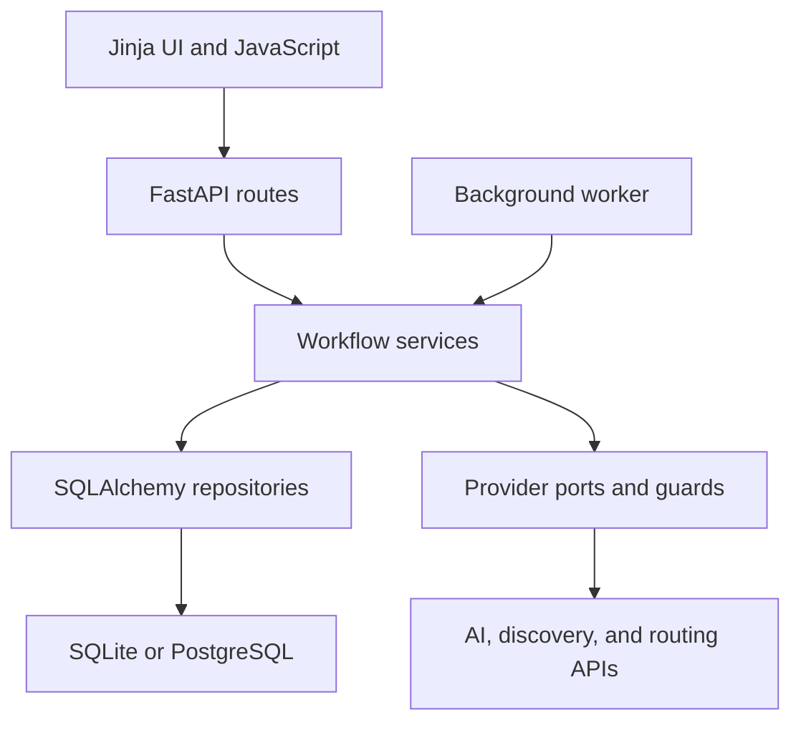

# Architecture

BetterOption is a Python application with a server-rendered web interface.
`ApplicationContainer` composes repositories, workflow services, and optional
provider adapters. The preserved application version is `0.7.2k`.

## Component relationships

| Responsibility | Implementation |
| --- | --- |
| Composition and settings | [container.py](../src/betteroption/container.py), [settings.py](../src/betteroption/settings.py) |
| HTTP requests and presentation | [web/app.py](../src/betteroption/web/app.py), [templates](../src/betteroption/web/templates) |
| Profile workflow and integrity | [profile_workflow.py](../src/betteroption/profile_workflow.py), [profile_integrity.py](../src/betteroption/profile_integrity.py) |
| Canonical jobs and revisions | [job_corpus.py](../src/betteroption/job_corpus.py), [job_repository.py](../src/betteroption/job_repository.py) |
| Scoring and result lifecycle | [matching.py](../src/betteroption/matching.py), [results.py](../src/betteroption/results.py) |
| Task ownership and cancellation | [background.py](../src/betteroption/background.py), [worker.py](../src/betteroption/worker.py) |
| Outbound work and budgets | [operations.py](../src/betteroption/operations.py), [provider_permissions.py](../src/betteroption/provider_permissions.py) |

## Evidence and matching

Profile extraction proposes structured facts with provenance and uncertainty.
Direct user answers and reviewed edits determine the active Compass. Indirect
CV/reference evidence has a separate review path. Missing evidence remains
unknown; it is not silently converted into a violated requirement.

Job ingestion keeps source observations, canonical revisions, URL aliases, and
quoted facts. URL-based imports apply redirect/network checks and availability
rules. Manual job input provides a separate path when a source cannot be fetched.

Python applies the matching rules. Optional model calls resolve selected
unresolved semantic relations from a minimized evidence payload; they do not
replace the deterministic scoring model. Result snapshots retain algorithm
identity and evidence fingerprints so changed inputs can invalidate old results.

Explore uses local approximate geography for candidate ranking. Explicit Match
runs can request exact route evidence. Approximate distance and provider-derived
journey times remain distinct in storage and presentation.

## Persistence and background execution

SQLAlchemy repositories use SQLite locally and PostgreSQL in the retained
hosted topology. Alembic owns schema upgrades; the final migration head is
`0033_background_task_leases`. Account and persona scopes separate private
profiles, saved jobs, results, and application state.

Long operations use persistent tasks. The local application can run an embedded
worker; the container topology uses a separate worker process. Leases,
heartbeats, retry limits, cancellation checks, and fenced commits prevent stale
workers from committing after losing ownership. Provider reservations are
persisted before outbound work so restart/cancellation does not erase budget use.

## Engineering trade-offs and limits

- Server rendering keeps the UI in one Python application; some HTTP and
  workflow modules grew large during iteration and would benefit from further
  decomposition.
- Provider adapters isolate failures and request contracts, but external APIs,
  source accessibility, and prices can drift after development ends.
- SQLite makes local evaluation straightforward; production concurrency and
  operations require a different deployment context.
- The code includes authentication, retention, export, and deployment controls.
  The repository is preserved as a prototype, with no supported hosted service.
- Tests cover scoring, evidence, source handling, account isolation, task
  lifecycle, and packaging. They cannot establish current live-provider behavior.

See [local development](local-development.md) for checks and
[engineering history](archive/engineering-history/README.md) for earlier designs.
