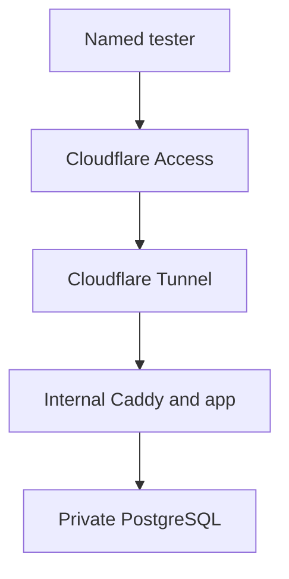

> **Discontinued product planning.** This document is retained from the discontinued MVP.
> Its release, launch, and future-work statements describe the original checkpoint.
> Start with the [technical documentation](../../README.md) for the portfolio overview.

# Private-alpha hosting and public gates — v0.7.2h

Status: current architecture and business-roadmap decision, dated 5 August
2026. This note does not deploy a server, invite a tester, enable billing, or
declare a legal/privacy gate complete. The executable tunnel-only sequence is
[`netcup-cloudflare-private-alpha-v0.7.2h.md`](../engineering-history/deployment/netcup-cloudflare-private-alpha-v0.7.2h.md).
The older `netcup-cloudflare-staging-v0.7.1*.md` files retain the superseded
direct-origin history and are not a current deployment path.

## Decision in one page

- Return to **Netcup**, using the current VPS 500 G12 class as the default
  private-alpha host. The previous operational familiarity and 128 GB storage
  are worth more than the small theoretical saving from changing provider.
- Put `alpha.<canonical-domain>` behind **Cloudflare Access with an exact-email
  allowlist** and keep the product's own account authentication. Access is an
  extra perimeter, not a replacement for tenant isolation or application roles.
- Prefer **Cloudflare Tunnel** for HTTP ingress. Close public origin ports 80
  and 443; restrict SSH separately. A proxied DNS record and Full (strict) TLS
  alone do not stop direct-origin bypass.
- Start the owner-only rehearsal with one named owner admin plus a sealed
  recovery credential. Before any friend receives an invitation, have
  **exactly two named human admins**: owner and incident/recovery backup. Five
  admin accounts would add attack surface without adding five independent
  responders.
- Give invited testers the full product experience, but never unlimited cost.
  A “max/testing” entitlement can expose all features while hard server-side
  per-user, per-workflow, daily, and global provider budgets remain active.
- Move provider ownership and billing to controlled business-domain email
  identities before friend alpha. Add real transactional email and verified
  email flows before public self-registration. Registrar forwarding is not an
  application mail service.
- Treat free and paid usage numbers as configurable hypotheses. Do not enable
  paid subscriptions until measured median and p90 cost, abuse behavior, tax,
  cancellation, refund, invoice, and payment-state handling all pass.

## EU host comparison

Prices and product pages were checked on 5 August 2026. Checkout country,
contract length, IPv4, VAT, promotions, and future price changes can change the
actual bill; verify the final German order before purchase.

| Host and comparable plan | Current official snapshot | Alpha advantages | Material limits | Decision |
| --- | --- | --- | --- | --- |
| [Netcup VPS 500 G12](https://www.netcup.com/en/server/vps) | €5.91/month incl. 19% VAT; 2 x86 vCore, 4 GB DDR5 ECC RAM, 128 GB NVMe, traffic, snapshots, remote console, DDoS protection; hourly/no-minimum option available | Already worked for this project; most storage; predictable small cost; Nuremberg, Vienna, and Amsterdam are available European locations, with redundant network and power described by [Netcup](https://www.netcup.com/en/about-netcup/data-center) | Shared VPS CPU; Netcup explicitly says this VPS does not include the root-server 99.9% annual minimum-availability guarantee; snapshots are not off-site backup | **Default: Netcup, preferably Nuremberg** |
| [OVHcloud VPS-1 Germany](https://www.ovhcloud.com/en-ie/vps/vps-deutschland/) | From €3.81/month ex. VAT; 2 vCore, 4 GB RAM, 40 GB NVMe, previous-24-hour daily backup, unlimited traffic, 500 Mbps, 99.9% SLA | About €1.38/month below Netcup after applying 19% VAT to the displayed ex-VAT price; included daily backup and stated SLA | One-third of Netcup storage; price shown on the Ireland storefront and must be confirmed for a German account; switching runbooks and provider has a migration cost | **Only meaningful Plan B** |
| [IONOS VPS M+](https://www.ionos.de/server/vps) | €3/month for three months, then €9/month, plus €10 setup, incl. VAT; 4 vCore, 4 GB RAM, 120 GB NVMe; unlimited traffic and a stated >99.99% availability | More vCPU and near-Netcup storage; German support proposition | Promo obscures the €9 steady-state price; roughly €100 in year one and €108 in a later full year at the displayed terms | Do not switch for this alpha |
| [Hetzner Cloud](https://docs.hetzner.com/general/infrastructure-and-availability/price-adjustment/) | From 15 June 2026, the Germany/Finland CX23 is €5.49/month and CPX22 €19.49/month, both excluding VAT and IPv4 | Mature EU cloud and hourly operations | The comparable low tier loses Netcup's storage/value after VAT and IPv4; the regular CPX tier is outside the present budget; the owner has already found it too costly | Do not choose now; revisit only when scaling evidence changes the trade-off |

At the displayed terms, Netcup VPS 500 is €70.92 per year. OVHcloud VPS-1 is
approximately €54.41 per year after applying 19% VAT to the displayed price, a
difference of about €16.51 per year. That saving does not compensate for a new
provider path and 88 GB less storage while Netcup is known to work. Provider
selection does not remove the need for monitoring, encrypted off-host backup,
or a timed restore drill.

Four GB RAM is a sensible starting size for 5–30 private-alpha users because the
expensive search and model work is external and queued. It is not a capacity
promise. Record resident memory, swap, database size, queue depth, p50/p90
request latency, worker lag, disk headroom, and OOM/restart events. Upgrade from
evidence, not from the number of registered accounts.

## Required Cloudflare boundary

The preferred request path is:

[Cloudflare Access applications deny by default](https://developers.cloudflare.com/cloudflare-one/access-controls/applications/http-apps/self-hosted-public-app/):
a user must match an Allow policy. For the small alpha, enable
[one-time PIN login](https://developers.cloudflare.com/cloudflare-one/integrations/identity-providers/one-time-pin/)
and list each approved tester email explicitly. Do not create a broad rule whose
only condition is the OTP login method; that proves control of *an* email
address, not membership in the alpha. Confirm the current free-plan seat and
retention terms at activation rather than embedding them as a permanent cost
assumption.

[Cloudflare Tunnel](https://developers.cloudflare.com/tunnel/) makes the origin
connection outbound-only. For this deployment that means:

- run the pinned `cloudflare/cloudflared:2026.7.3` service and pass the
  remotely-managed connector credential through the official
  `TUNNEL_TOKEN_FILE` mechanism backed by a mode-`600`, gitignored Docker
  secret file; do not put the connector token in `deploy/.env.staging`, where
  unrelated app and retention containers would inherit it;
- configure `TUNNEL_METRICS` and the built-in `cloudflared tunnel ready`
  healthcheck so a running process is not mistaken for an active edge
  connection;
- create the deny-by-default Access application and its exact-email policy
  **before** publishing the route;
- route only the intended alpha hostname to `http://caddy:80`, enable the route's
  **Protect with Access** token validation, and keep Caddy on internal HTTP
  (`http://{$SITE_ADDRESS}`) because browser TLS terminates at Cloudflare;
- expose no host port 80 or 443 to the public Internet;
- keep FastAPI and PostgreSQL on the private Compose network;
- restrict SSH to key authentication and an operator IP or a separately tested
  access path; Tunnel for the web app does not secure an unrelated SSH listener;
- alert on a disconnected tunnel and document token rotation and emergency
  removal;
- use a narrow Access service token for the external monitor—never a blanket
  public bypass—and verify that an ordinary unauthenticated request to
  `/health/ready` receives the Access challenge rather than application health.

Cloudflare Access stays in front of the application's own login. The app still
enforces account, persona, job, operator, and tenant authorization. Keep the
current application session and exact-email invitation controls. Validate the
[Access JWT](https://developers.cloudflare.com/cloudflare-one/access-controls/applications/http-apps/authorization-cookie/validating-json/)
at the origin if application logic consumes Access identity or any path can
reach the service outside the protected hostname.

Under this tunnel-only topology, `CF-Connecting-IP` can be trusted for the
application's authentication rate limit only after the negative direct-origin
test passes. Set `BETTEROPTION_AUTH_TRUST_CLOUDFLARE_HEADERS=true` for that
accepted topology; set it back to `false` if any public web listener is restored.

### If Tunnel cannot be used

Do not fall back to “orange cloud plus open 443.” The minimum reviewed
alternative is Full (strict) TLS, firewall ingress limited to current Cloudflare
source ranges, an account-specific zone or hostname
[Authenticated Origin Pull](https://developers.cloudflare.com/ssl/origin-configuration/authenticated-origin-pull/)
certificate, and origin validation of the Access assertion. Cloudflare warns
that without AOP someone who discovers the origin IP can bypass Cloudflare.
AOP and Tunnel are alternatives: AOP does not apply to a Tunnel origin because
the Tunnel already authenticates through connector credentials.

The old staging setting that refuses to trust `CF-Connecting-IP` while the
origin is public remains correct. Turn Cloudflare-header trust on only after a
tested origin restriction makes direct forged requests impossible.

Access and OTP introduce another processor and another authentication log.
Record Cloudflare in the processor/subprocessor and data-flow reviews, accept
the applicable DPA, choose justified log retention, and verify deletion/access
procedures before inviting external testers.

## Accounts, roles, and administrators

The production database starts clean. Local first-user state and the discarded
historical hosted database must not decide production authority.

The bootstrap contract should be:

1. Staging begins in `first_user` mode only long enough to create the owner in a
   clean production account table.
2. That transaction grants the owner role and immediately closes bootstrap.
3. Redeploy with `invite_only` before any tester access; an account ordinal such
   as ID 1 is never re-evaluated as “admin.”
4. Later role grants and revocations are explicit, audited, revocable, and
   visible in Operations.

Separate authority from product entitlements:

| Concept | Grants | Must not grant |
| --- | --- | --- |
| Owner/operator admin | Operations, incident response, invitations, role and budget control | Another user's Compass or job content except through a separately justified support flow |
| Job poster | Existing employer/job-posting functions for an authorized organization | Candidate Operations or global configuration |
| Invited tester | Normal product access plus a generous test-plan entitlement and feedback entry point | Infrastructure or operator privileges |
| Free/paid plan | Feature and usage limits | Administrative authority |

One owner admin is acceptable only for the owner-only rehearsal when a sealed
break-glass recovery credential exists offline. Before friend alpha, configure
**two named human admin accounts**: the owner and one real recovery/incident
backup. Use separate accounts, passkeys or strong MFA, offline recovery material,
least privilege, and ordinary non-admin accounts for daily product use. Audit
every privileged change and test recovery.

Do not create five admins merely to reach a number. Five credentials held by one
person are not redundancy; five broadly privileged people are unnecessary for
a small alpha. Expand beyond two only when separate on-call, support, security,
or finance duties have named humans and narrower roles.

## Business identities, provider billing, and mail

Before friend alpha, each enabled infrastructure, model, search, routes,
transactional-mail, monitoring, and payment account must have:

- a controlled business-domain ownership email rather than a personal mailbox;
- two named recovery contacts where the provider supports them, without shared
  passwords;
- strong MFA, password-manager custody, and documented recovery codes;
- the real legal person/entity and billing address on invoices—never an invented
  company identity;
- environment-specific API keys, least scopes, rotation dates, spend alerts,
  and a named cancellation owner;
- recorded price, currency, VAT/tax treatment, contract, DPA, subprocessors,
  data locations/transfers, retention, and service-disable procedure.

An address such as `ops@<domain>` may be a routed team identity, but registrar
email forwarding alone is not a durable mailbox and cannot send application
mail. Choose a transactional-email provider under a reviewed DPA, use a
dedicated sender or subdomain, and configure SPF, DKIM, and
[DMARC](https://datatracker.ietf.org/doc/html/rfc7489). Monitor bounces and
complaints, maintain suppression, rotate credentials, and separate security
mail from marketing mail.

Before public registration, email verification and recovery must use random,
single-use, expiring tokens; store only hashes; consume them atomically; rate
limit issue and resend; avoid account-enumerating responses; revoke affected
sessions after recovery; and never log tokens or message bodies. Test delayed,
duplicated, bounced, expired, and replayed messages. Every non-essential email
needs clear consent, preference control, and unsubscribe behavior.

## Usage and subscription hypothesis

The owner's draft numbers are useful as configuration hypotheses, not promises:

- 1–5 Compass personas;
- 200 Compass adjustments shared across personas;
- 125 active job slots, expressed as five personas × 25;
- up to 25 searches, 25 full matches, and 25 draft creations per day.

Keep every limit configurable by plan and environment. Model product units
separately—personas, active job slots, Compass mutations, searches, provider
calls, full matches, draft generations, and scheduled notifications—because
they have different cost and abuse profiles. A single “requests” counter cannot
protect the budget honestly.

For the private alpha, assign invited testers a **test/max plan** so they can
exercise the whole story. “Max” still has:

- atomic reservation before paid work starts;
- per-workflow, per-account, per-day, and deployment-wide ceilings;
- idempotency and concurrency protection so retries do not double-spend;
- a global provider kill switch and alerts before the financial limit;
- transparent release/refund of reserved quota when a workflow fails before
  consuming the paid resource;
- Operations visibility using counts and cost metadata, never private payloads.

For public release, start simpler than the brainstorming range. A reasonable
experiment is two free personas with conservative observed-cost limits, and a
paid tier with five personas and larger limits. Do not advertise exact numbers
until the ten-run cost calibration and real alpha usage show that median and
p90 contribution margin survive repeat behavior. Ten or twenty personas belong
to later evidence, not the first pricing page.

Scheduled job email should also be a costed, opt-in entitlement. Prefer one
batched ranking/search job per subscribed user per day at most and, initially,
no more than two digest emails per week. A rare immediate “new top match” alert
can be separately opted in and capped. Three or four unsolicited emails per day
would create fatigue, deliverability risk, and unnecessary provider spend.

## Billing gate

Do not connect subscription price directly to a mutable UI role. Entitlements
must be derived from an audited plan state, while payment status remains a
separate ledger. Before taking money, complete all of the following:

- measured median and p90 cost for Explore, Match, draft, scheduled search, and
  support-heavy repeat use;
- accepted free and paid limits with budget-exhaustion UX and no surprise
  partial charges;
- legal price display, VAT/tax, invoice, trial, renewal, cancellation, refund,
  chargeback, and credit decisions for the launch markets;
- signed payment webhooks with replay protection and idempotent state changes;
- explicit handling for pending, failed, refunded, disputed, past-due, and
  cancelled payments without deleting user data opportunistically;
- reconciliation, support, processor/DPA review, restricted finance access, and
  a tested provider-disable path.

The existing EUR 4 and EUR 8 price ideas remain hypotheses until those gates
pass. Billing is not required for the private alpha; cost controls are.

## Exposure gates

| Stage | Required evidence before entry | Product experience |
| --- | --- | --- |
| Owner-only online rehearsal | Fresh Netcup deploy; Tunnel/origin restriction; Access owner allowlist; clean bootstrap; off-host encrypted backup; health/worker/disk/database alerts; restore and rollback rehearsal | Full product, one owner admin plus offline break-glass recovery |
| Closed friend alpha, first batch | Everything above; second named human admin; exact-email invitations; business-domain vendor ownership; provider billing/spend alerts; processor and legal readiness; measured workflow cost; support/deletion/security contact | Full test/max plan under hard hidden safety budgets; 5–10 named testers |
| Expanded private alpha | Stable first batch; no cross-account exposure; incident, deletion, export, quota-exhaustion, and provider-disable drills; p90 cost and support load accepted | Up to 30 named testers; tune entitlements from evidence |
| Public registration | Verified transactional email and recovery; server-verified Turnstile and registration rate limits; direct origin still closed; public plan limits; abuse controls; real legal text; support capacity; billing gate if paid | Deliberate free/paid plans, not the uncapped test entitlement |

Cloudflare Access is intentionally a private-alpha gate. Before public
self-registration, remove or narrow the Access application so unknown users can
reach the public registration surface, while keeping the origin restricted to
Cloudflare. Public registration must then rely on the product's verified email,
server-verified Turnstile, rate limiting, abuse controls, and app authorization.
Do not expose the origin as a shortcut around those controls.

## Recommended implementation order

Use the exact commands, negative origin tests and restore/rollback record in the
[`v0.7.2h` private-alpha runbook](../engineering-history/deployment/netcup-cloudflare-private-alpha-v0.7.2h.md).

1. Order the Netcup VPS only after confirming the displayed contract, VAT,
   location, IPv4, and cancellation terms; harden key-only SSH and deny inbound
   web ports.
2. Stage one tagged/reproducible source state and server-only secrets without
   starting the app; prepare off-host encrypted backup, alerts, restore,
   rollback, and secret rotation.
3. Create the exact-email Access application and owner Allow policy, plus the
   narrower service-token health policy, while no hostname route exists.
4. Create the remotely managed Tunnel, install its mode-`600` Docker secret,
   route only the alpha hostname to `http://caddy:80`, and enable Protect with
   Access.
5. Deploy into a clean PostgreSQL database in `first_user`, create the single
   owner, switch immediately to `invite_only`, and pass the external origin,
   unauthenticated Access and authenticated health tests.
6. Run owner-only cost, isolation, failure, recovery, restore and rollback
   exercises.
7. Move vendor ownership/billing to controlled business-domain identities,
   complete processor/legal gates, and add the second human admin.
8. Invite at most five friends in the first batch with the test/max entitlement
   and explicit stop conditions.
9. Implement transactional verification mail, public quotas, abuse controls,
   and billing only in the evidence-gated public sequence.

An online server is not permission to invite users. The canonical launch record
and compliance dossier still own that decision. This is an engineering and
operating recommendation, not legal, tax, accounting, or trademark advice.
