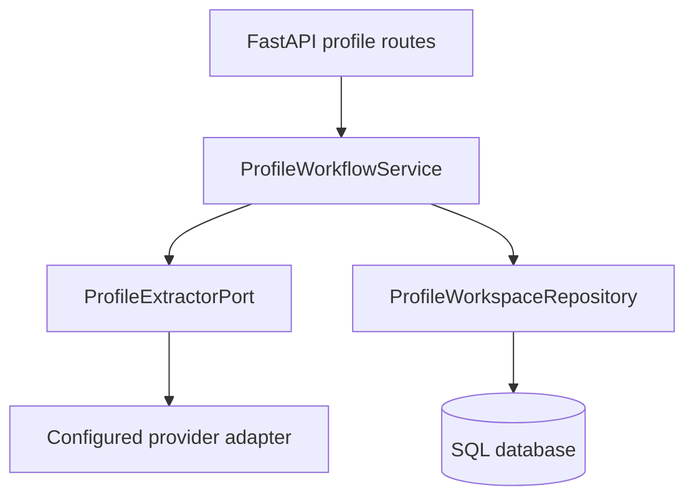
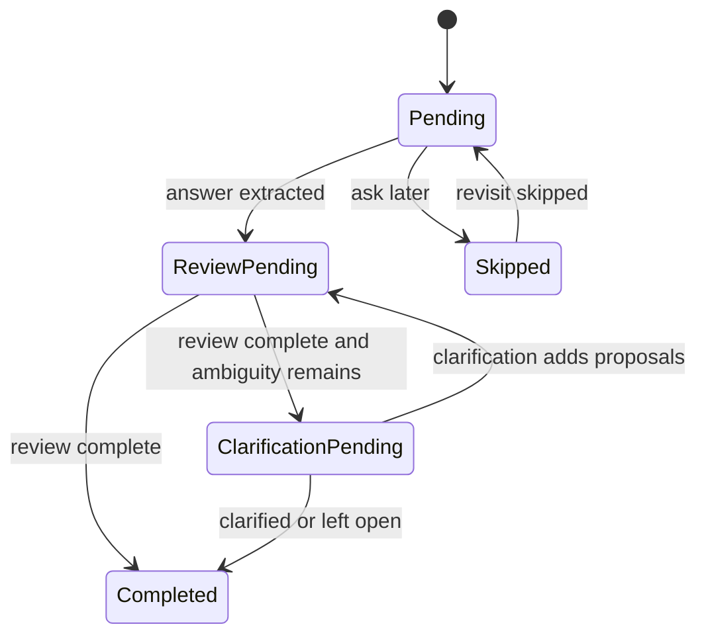

> **Historical engineering record.** This document is retained from the discontinued MVP.
> Its release, launch, and future-work statements describe the original checkpoint.
> Start with the [technical documentation](../../../README.md) for the portfolio overview.

# Application Architecture v0.6.3

## Purpose

v0.6.3 makes the guided profile and Review Tray a real web workflow while
preserving the application boundaries established in v0.6.2. It does not pull
the opportunity inbox or matching-result experience forward.

## Request path

- FastAPI owns HTTP parsing, redirects, templates, and friendly errors.
- `ProfileWorkflowService` owns conversation transitions and safe mutations.
- `ProfileExtractorPort` keeps provider code outside the workflow and domain.
- `ProfileWorkspaceRepository` is the only web profile persistence adapter.
- `ProfileSession`, `CandidateProfile`, facts, and review events remain typed
  domain state and do not import FastAPI, SQLAlchemy, or OpenAI.

## Database contract

Alembic revision `0003_profile_workspaces` adds two tables:

| Table | Purpose | Content boundary |
| --- | --- | --- |
| `profile_workspaces` | Complete typed profile-session checkpoint | Private profile state as validated JSON |
| `conversation_messages` | Resumable section conversation | User and assistant messages |

The database is authoritative for the web flow. The newest legacy
`session-*.json` checkpoint is imported only when no database workspace exists.
The import is idempotent and subsequent writes remain database-only.

Only one workspace is active in the private-alpha experience. The schema keeps
workspace IDs explicit so per-user ownership can be added with authentication
in v0.6.8 without changing the profile domain.

## Conversation state machine

Every answer is saved before its structured facts are activated. Review Tray
actions for indirect evidence are saved individually. Restarting the application
therefore returns to the first unfinished indirect-evidence review or
clarification instead of repeating extraction.

## User-authority boundary

- A model may produce only `explicit` or `inferred` proposals.
- A direct user answer activates its extracted facts; explicit Review Tray and
  edit actions create later `confirmed` or `rejected` state changes.
- Confirm, edit, category change, and rejection append review events.
- A later extraction can refresh an unreviewed duplicate but cannot overwrite
  a confirmed, edited, recategorized, or rejected fact.
- An edited value and category are saved as one web decision with a complete
  audit trail.
- Candidate evidence from the experience section stays separate from future
  search preferences.

## Reference-job boundary

The form accepts a URL, positive observations, negative observations, and an
optional learning scope. It never accepts copied advertisement text.

Before persistence, `PublicUrlFetcher` validates HTTP(S), DNS targets,
redirects, robots policy, response status, content type, size, useful text, and
soft-expiry markers. Only a successful 2xx fetch creates a reference. The
requested and resolved URLs, HTTP status, and verification timestamp are stored.

The learning switch in v0.6.3 records explicit permission and scope. It does
not yet mutate the profile from job content. Reference-derived proposals belong
to the opportunity workflow and must still pass through the Review Tray.

## Privacy and packaging

- Runtime profile data is excluded from source archives.
- `.env`, API keys, databases, uploads, CVs, caches, and `local-data` are
  excluded by `scripts/build_release.py`.
- Model invocation telemetry contains task, model, prompt version, usage,
  latency, outcome, and optional configured cost—not prompts or answers.
- Local SQLite is not encrypted by the application. Disk protection and a
  deletion/export policy are required before external alpha accounts.

## Deliberately deferred

- v0.6.4: opportunity inbox, URL imports, refresh states, job detail revisions.
- v0.6.5: Top/Stretch/Blocked result views, evidence explanations, feedback,
  shortlist, and application states.
- v0.6.6+: commute routing, CV data, authentication, account isolation, and
  operational administration.
