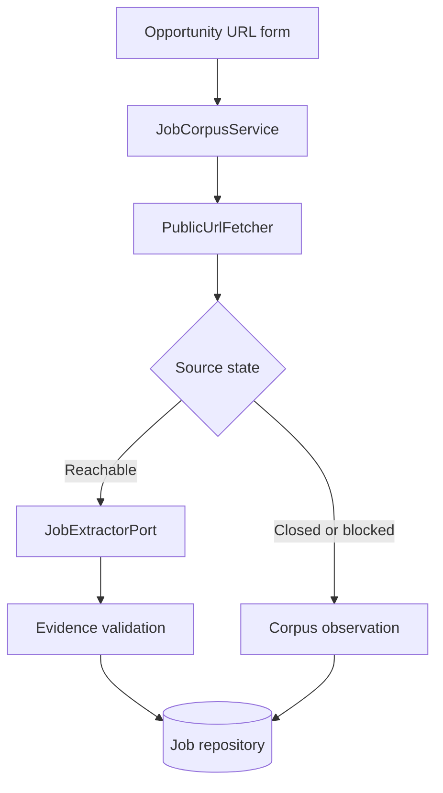

> **Historical engineering record.** This document is retained from the discontinued MVP.
> Its release, launch, and future-work statements describe the original checkpoint.
> Start with the [technical documentation](../../../README.md) for the portfolio overview.

# Application Architecture v0.6.4

## Purpose

v0.6.4 exposes the existing revisioned URL corpus as a safe web opportunity
inbox. It preserves the v0.6.3 profile flow and visual system. Matching-result
presentation, feedback, applications, and subscriptions remain outside this
increment.

## Import path

- FastAPI validates that the input is an HTTP(S) job URL before fetching.
- The public fetcher applies DNS, redirect, robots, response, content, size, and
  soft-expiry checks.
- The job extractor is created lazily only for a reachable new or changed page.
- Every canonical job fact must cite text present in the advertisement.
- The repository persists URL aliases, current state, observations, and
  append-only revisions.
- Import and refresh routes are synchronous functions, so FastAPI runs blocking
  fetch/model work outside the event loop.

## Inbox states

| State | Meaning | Presentation behavior |
| --- | --- | --- |
| `live` | Reachable and canonically extracted | Eligible for later matching |
| `expired` | HTTP 404/410 or a recognized closed-job page | Retained under Closed |
| `unreachable` | Network, robots, content, or temporary access failure | Retained for recheck |
| `needs_attention` | Reachable, but extraction or validation failed | Retained for extraction retry |

An initial failure therefore creates a visible inbox item instead of silently
disappearing. A later successful refresh can recover the same record to `live`
without changing its identity or losing its history.

## Revision contract

- A first successful extraction creates Version 1 and a `new` observation.
- Identical source text creates an `unchanged` observation, refreshes URL
  metadata, and reuses the current extraction.
- Changed source text creates a new canonical revision and a `changed`
  observation.
- Closed, unreachable, and extraction-failed checks never invent or overwrite
  job facts.
- A prior successful revision is retained when a later check fails.

The job detail page shows the direct URL, current state, last HTTP response,
check history, and saved revision hashes/timestamps. Only a currently live item
is labeled as a verified job page.

## Reference jobs versus inbox jobs

A profile reference is preference evidence and must be reachable before it is
saved. An HTTP 404 reference remains rejected.

An inbox import is operational search memory. Failed URLs are retained with an
honest state so users can distinguish closed, blocked, and retryable sources.
These two behaviors are intentional and should not be merged.

## Free access policy

`ProductAccessPolicy.free_match_result_limit` is fixed at `3`. v0.6.4 displays
that product promise but does not yet present or gate match results. v0.6.5 must
apply the policy to the first three useful result cards before any subscription
gate. URL imports themselves are not counted as free results.

## Database and privacy

No v0.6.4 schema migration is necessary: the v0.6.0 corpus tables already use
extensible string states and revision/observation rows. Database head remains
`0003_profile_workspaces`.

Runtime profiles, databases, source snapshots, canonical-job files, `.env`, API
keys, CVs, and uploads remain excluded from release archives. Source snapshots
are local diagnostic data and are not served by the web application.

## Deliberately deferred

- Background import queues and multi-worker processing before public scale.
- Top/Stretch/Blocked result presentation and the three-result access gate.
- Feedback, application tracking, subscriptions, billing, and authentication.
- Commute calculations, CV ingestion, and automated application documents.
