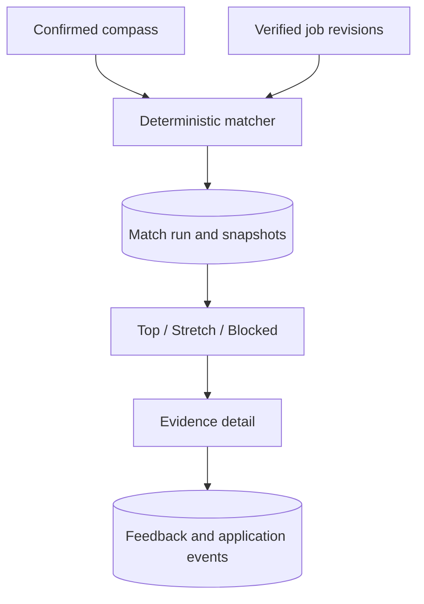

> **Historical engineering record.** This document is retained from the discontinued MVP.
> Its release, launch, and future-work statements describe the original checkpoint.
> Start with the [technical documentation](../../../README.md) for the portfolio overview.

# Application Architecture v0.6.5

## Purpose

v0.6.5 exposes the existing deterministic matcher as a traceable web result
experience. The LLM extracts profile and advertisement facts, but it does not
choose filters, scores, groups, access, feedback, or application state.

## Result flow

An explicit **Create my matches** action reads the active profile workspace and
only currently live canonical jobs. A link older than the corpus freshness
window is rechecked before it can enter a new run. The run stores:

- the exact profile snapshot used;
- the exact canonical job snapshot used for every result;
- the deterministic score, group, hard-boundary coverage, skill coverage, and
  complete reason list;
- the direct source URL and its successful verification metadata.

Page refreshes read the saved database run and do not invoke an LLM or create a
new result set.

## Page story

The private-alpha navigation has one responsibility per page:

- **Compass** starts, resumes, reviews, or explicitly restarts the nine-part
  profile conversation.
- **Matches** is the only visible job-entry point. One form verifies and stores
  the URL together with positive, negative, and opt-in learning settings.
- **Opportunities archive** displays stored sources, status, revisions, and the
  confirmed deletion control. It has no competing import form.

The profile reference and job corpus models remain separate internally because
they carry different evidence. The Matches application flow updates both from
one verified fetch, so the interface does not expose that implementation split.

## Groups and evidence

| Group | Rule | Product behavior |
| --- | --- | --- |
| Top | No proven hard conflict and sufficient supported fit | Present as the strongest current evidence |
| Stretch | One hard conflict, lower evidence, or meaningful uncertainty | Show **Why still apply?** and the unknowns |
| Blocked | Two or more distinct hard conflicts | Keep visible so exclusions are transparent |

Every reason identifies the confirmed profile fact, its deterministic outcome,
and any verbatim advertisement evidence. Missing proof remains `unknown`.
Unknown is never silently treated as satisfied.

## Free-result boundary

`ProductAccessPolicy.free_match_result_limit` and `max_stored_jobs` are both `5`.

- Grants belong to the profile workspace and job record, not a browser session
  or one match run.
- A sixth new URL is rejected before fetching or LLM extraction. Refreshing an
  already stored URL remains allowed.
- A new run fills any unused allowance with its highest ranked Top/Stretch jobs.
- Rerunning never resets or expands the allowance.
- Later Top/Stretch cards do not disclose job identity, URL, or match evidence.
- Blocked results remain inspectable because they are exclusion explanations,
  not recommendations.
- Because the free archive also holds at most five jobs, every stored
  Top/Stretch result is inspectable without an email gate.

Confirmed deletion removes the selected record, aliases, revisions,
observations, match results, access grants, interactions, interaction events,
reference settings, and targeted local reproducibility files. SQLite foreign
keys are explicitly enabled so the same declared cascade behavior used by
PostgreSQL is enforced in local development. Deletion frees one storage and
result slot.

The generic Opportunity page also masks scores and reasons for locked results,
preventing an alternate-route bypass. Subscriptions and payment collection are
still deferred.

## Feedback and application state

The current interaction row supports explicit signals including:

- Interesting
- Not relevant
- Too much consulting
- Too little development
- Too senior
- Role good, context wrong

An optional note retains the user's own language. Feedback is stored as a
signal and never mutates the compass automatically.

Application states progress independently through Discovered, Saved, Preparing,
Applied, Interview, Rejected, Offer, and Withdrawn. Every feedback or application
change also creates an append-only event.

## Staleness and source integrity

A saved run remains an immutable explanation of what was known then.

- If the profile changes, the result page asks for a rerun.
- If a job revision changes or closes, the prior evidence remains visible but
  the verified-source action is withheld.
- A new run creates new rows; it never overwrites an old run.

## Database migration

Alembic head `0004_match_results` adds:

- `match_runs`
- `match_results`
- `result_access_grants`
- `job_interactions`
- `job_interaction_events`

Runtime profile/job snapshots, decisions, databases, `.env`, API keys, CVs, and
uploads remain excluded from Git and release archives.

## Deliberately deferred

- Automated sourcing beyond user-imported and later curated company URLs.
- Subscription checkout, billing, authentication, and account-level entitlements.
- Actual road/rail/bicycle/walking commute calculation.
- CV ingestion, tailoring, cover letters, and application automation.
