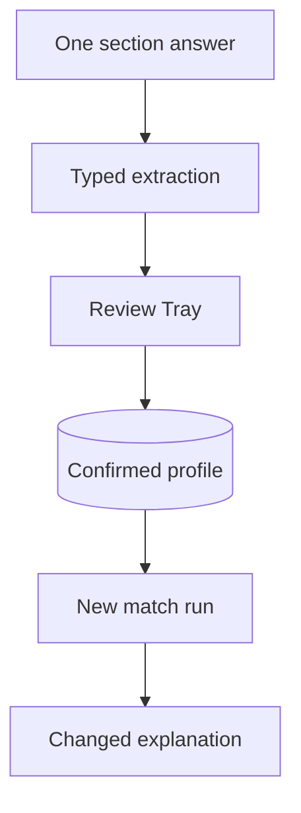
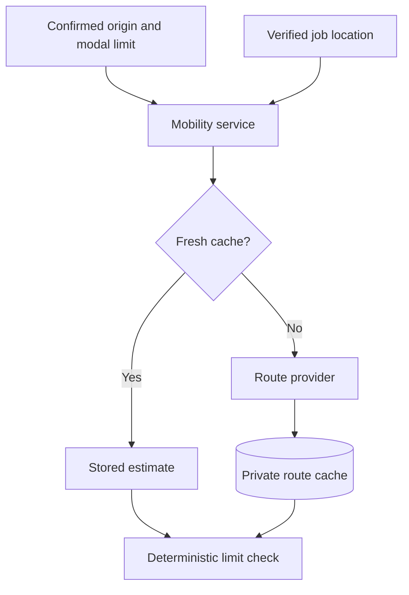

> **Historical engineering record.** This document is retained from the discontinued MVP.
> Its release, launch, and future-work statements describe the original checkpoint.
> Start with the [technical documentation](../../../README.md) for the portfolio overview.

# Application Architecture v0.6.6

## Purpose

v0.6.6 makes profile revision incremental, recalibrates deterministic matching,
and adds an optional cached commute-time boundary. The accepted visual system
and the evidence-first product contract remain unchanged.

The LLM may extract candidate and advertisement facts. Python remains the sole
authority for confirmation state, hard filters, route-limit evaluation, scores,
result groups, free access, feedback, and application state.

## Page story

The private-alpha navigation has one responsibility per page:

- **Compass** displays the active confirmed profile. Each of the nine sections
  accepts an isolated addition or correction, and every confirmed fact can be
  edited, reclassified, or removed without replaying onboarding.
- **Matching** owns reference-job input, optional reference-learning controls,
  explicit match creation, and Top / Stretch / Blocked results.
- **Archive** owns persisted sources, lifecycle state, checks, extraction,
  revisions, retry, and confirmed deletion.

The guided nine-section flow remains available below the Compass editor. It is
useful for first onboarding or an explicit clean restart, but it is no longer
required for normal profile maintenance.

## Incremental Compass flow

An isolated section answer appends raw input and proposes only new reviewable
facts. Existing user-confirmed decisions are protected. Direct edits and
removals create append-only review events. If a Review Tray is already open,
direct mutation is blocked until those pending proposals are resolved.

## Compatibility and evidence coverage

Compatibility answers: “Does the available evidence conflict with or support
this person’s direction?” Evidence coverage answers: “How much of the Compass
can this advertisement actually prove?” They are displayed and stored
separately.

- Missing advertisement information remains unknown.
- Unknown preferences do not subtract compatibility points.
- Supported direction, role, career, and industry evidence raises
  compatibility.
- Proven hard conflicts lower compatibility and determine Stretch or Blocked.
- Required-skill evidence is compared with confirmed candidate evidence.
- A job with no useful support remains a neutral Stretch result, not an
  artificially strong Top result.

The current deterministic algorithm is identified as `matching-v0.6.6` on each
saved run. Older saved runs remain immutable and are visibly marked for rerun.

## Commute flow

Supported travel modes are car, public transit, bicycle, and walking. The
profile extractor uses stable semantic keys such as `location.origin` and
`commute.transit.max_minutes`. It must not infer a route time from straight-line
distance.

The mobility adapter boundary accepts origin, destination, mode, and departure
time. The current Google Routes adapter requests only route duration and
distance. An unavailable provider implementation is the safe default when no
key is configured.

Route cache properties:

- scoped to profile workspace, job record, mode, and normalized query;
- refreshed after seven days;
- successful routes and explicit no-route responses may be cached;
- provider failures are not converted into facts;
- job or profile deletion cascades to private cache rows.

Only a successfully calculated duration can satisfy or violate a commute
limit. Missing origin, missing destination, provider failure, and no route are
presented as explicit uncertainty.

## Free alpha boundary

`ProductAccessPolicy.free_match_result_limit` and `max_stored_jobs` are both
`25` for the current alpha.

- Grants belong to the profile workspace and job record.
- A 26th new URL is rejected before network or model work.
- Refreshing an existing URL remains allowed.
- Confirmed deletion removes the selected job's dependent history and frees one
  storage/result slot.
- Blocked explanations remain inspectable because they explain exclusions.

Subscriptions and payment collection remain deferred.

## Database migration

Alembic head `0005_commute_estimates`:

- adds `algorithm_version` to `match_runs` with a safe legacy default;
- creates `commute_estimates` with profile/job foreign keys, normalized query
  identity, duration, optional distance, provider metadata, and observation
  time;
- preserves all v0.6.5 data and cascade behavior.

Runtime profiles, jobs, route estimates, results, decisions, databases, `.env`,
keys, CVs, and uploads remain excluded from Git and release archives.

## Deliberately deferred

- Automated discovery beyond user-imported and later curated company URLs.
- Authentication, subscriptions, billing, and account entitlements.
- Production provider quotas, operational retry queues, and route-cost budgets.
- CV ingestion, tailoring, cover letters, and application automation.
