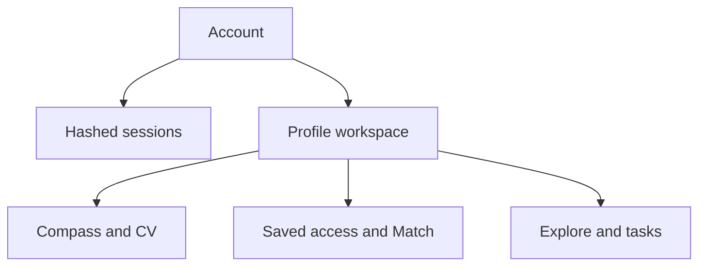

> **Historical engineering record.** This document is retained from the discontinued MVP.
> Its release, launch, and future-work statements describe the original checkpoint.
> Start with the [technical documentation](../../../README.md) for the portfolio overview.

# Application architecture v0.7.0

## Modes

BetterOption has two explicit runtime modes.

| Mode | Purpose | Authentication |
| --- | --- | --- |
| `local` | Accepted single-user desktop/private-alpha workflow | None |
| `accounts` | Controlled tenant-isolation and account tests | Required |

Account mode is opt-in so installing v0.7.0 does not lock an existing local user
out of their workspace.

## Tenant root

`accounts` is the identity root and `profile_workspaces.account_id` establishes
ownership. Existing private aggregates already use `workspace_id`, so deleting
the workspace removes its complete private graph through database foreign keys.

Job advertisements remain public source data. `result_access_grants` links a
workspace to the public job records it may see. This avoids duplicating public
source snapshots while keeping private profile, decision, and application data
isolated.

## Request boundary

In account mode, middleware:

1. hashes the opaque session cookie and resolves an unexpired session;
2. redirects anonymous browser requests to sign-in and returns `401` to API
   requests;
3. stores the authenticated account in request-local context;
4. rejects state-changing cross-origin requests;
5. scopes every private repository query to the account-owned workspace.

Routes that receive a workspace, job, or task identifier verify ownership or an
access grant before rendering or mutating it. A guessed UUID does not cross the
tenant boundary.

## Authentication storage

- email addresses are normalized and unique;
- passwords use salted scrypt hashes;
- random browser-session tokens are returned once and only SHA-256 hashes are
  stored;
- session cookies are HttpOnly and SameSite=Lax;
- session lifetime and Secure-cookie behavior are configurable.

No password, token, API key, CV, prompt, route endpoint, or search text enters the
provider-operation ledger.

## Legacy migration

Migration `0013_accounts_tenants` adds accounts, sessions, and nullable workspace
ownership. Local mode continues to use unowned workspaces. In account mode, the
first owner may atomically claim legacy unowned workspaces and receives access
grants for the existing public job corpus.

Recommended sequence:

1. back up `local-data/betteroption.db`;
2. install v0.7.0 and verify local mode;
3. set account mode and `first_user`;
4. register the owner and verify the existing Compass and Archive;
5. set registration to `disabled`;
6. use `open` only temporarily for an explicit isolation test.

## Export and deletion

Export serializes the account's private database graph without authentication
secrets. Account deletion verifies the password, deletes the account row, and
relies on database cascades for sessions and workspace descendants. Shared public
job-source rows are intentionally preserved.

## Production gap

The in-process worker and SQLite remain appropriate for local testing. An online
alpha requires PostgreSQL, a separately supervised worker, HTTPS, secure cookies,
email verification/recovery, invitation controls, rate limiting, stronger CSRF
tokens, backups, monitoring, and tested operational restore/deletion procedures.

